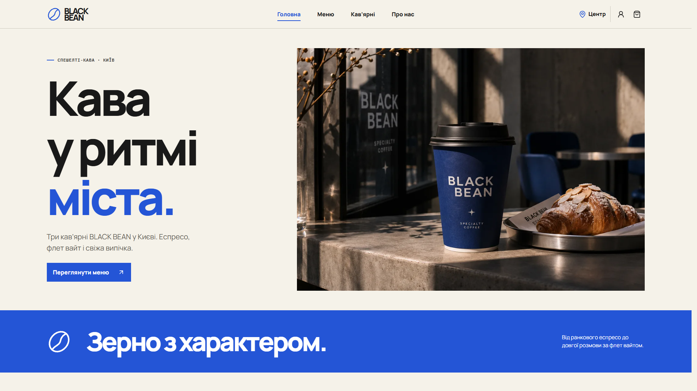
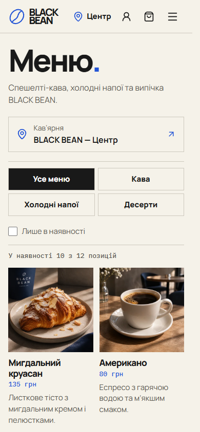
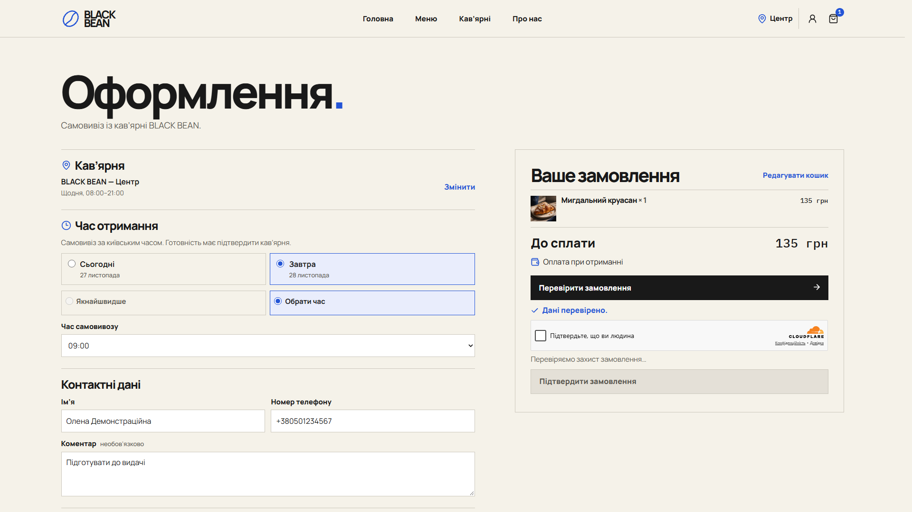

# BLACK BEAN

BLACK BEAN is a demonstration e-commerce experience for a Kyiv specialty coffee network. The project combines an editorial brand presence with a practical pre-order flow for three coffee shops: customers can explore the menu, choose a location and pickup time, place an order, and manage their loyalty account in one focused interface.

Live demo: [black-bean-beta.vercel.app](https://black-bean-beta.vercel.app/)

> This is a portfolio project and demonstration environment. It is not a production ordering service.

## Product concept

BLACK BEAN is built around the rhythm of an urban specialty coffee brand: carefully presented coffee, a concise menu, clear location information, and a fast pickup experience. The interface uses a warm milk background, graphite typography, cobalt actions, Manrope for UI text, and IBM Plex Mono for operational details.

## User experience

- Browse drinks, desserts, products, ingredients, sizes, milk options, and add-ons.
- Check availability by coffee shop and build a cart with server-validated prices.
- Choose a pickup location and order for today or tomorrow.
- For today, select “as soon as possible” or an available pickup time; for tomorrow, select a 15-minute slot.
- See opening hours, including schedules that cross midnight, in the Europe/Kyiv time zone.
- Continue as a guest or create an account with Supabase Auth.
- Confirm an order with a short public number such as `BB-000128` while the UUID remains the internal identifier.
- Review order status, items, total, pickup date and time in the account history.

## Account and loyalty

Registered customers can:

- sign up, sign in, confirm email, recover a password, sign out, and restore a session after reload;
- edit their name and phone number;
- view their own orders and bonus transaction history;
- spend up to 30% of an order total using bonus balance;
- receive the expected 5% bonus accrual shown before checkout.

Prices, bonus deductions, accruals, refunds, availability, pickup windows, and order transitions are calculated and validated on the server. Guest checkout remains available and is not automatically connected to a later account by matching contact details.

## Administration

The protected `/admin` workspace is available only to authenticated users whose account has an administrative record in the database. It provides:

- revenue, order count, average check, active orders, period filters, and coffee-shop filters;
- order search, filters, details, payment confirmation, completion, cancellation, and status transitions;
- menu price, variant, modifier, and location availability management;
- coffee-shop opening-hours and location assortment management;
- registered customer views with their orders and bonus transactions.

Administrative operations use server authorization, RLS, and controlled RPCs. The client cannot grant roles, alter bonus balances, change historical order prices, or transition orders outside the permitted workflow. The local administrator setup procedure is documented in [`docs/LOCAL_ADMIN.md`](docs/LOCAL_ADMIN.md).

## Order protection and authorization

Order creation goes through the server endpoint `/api/place-order` and requires Cloudflare Turnstile verification for both guests and authenticated customers. The token is checked with Cloudflare on the server and is never trusted from client-side state alone. The former public order-creation RPC is not executable by anonymous or regular authenticated clients; the protected server path invokes the trusted database function only after CAPTCHA and identity checks.

Supabase Auth manages customer sessions. Supabase RLS isolates personal data and administrative data. Server-only Supabase and Turnstile credentials are never exposed through `VITE_*` variables or shipped to the browser. The database remains the source of truth for prices, bonuses, inventory, pickup schedules, idempotency, and order ownership.

## Technology and architecture

- React 19 with React Router for the responsive client application.
- Vite for development and production builds, with lazy-loaded account and admin routes.
- Supabase Auth, PostgreSQL, RLS, SQL migrations, and server-side RPCs.
- A small Vercel Web API handler for protected order creation and Turnstile verification.
- Cloudflare Turnstile for anti-automation protection.
- Shared CSS tokens for the BLACK BEAN visual system.
- Local fonts and responsive WebP assets; no external UI framework or unnecessary runtime dependency.

The code is organized by responsibility: shared UI lives in `src/components`, page routes in `src/pages`, domain workflows in `src/features`, formatting and clients in `src/lib`, server handlers in `api` and `server`, and database migrations and tests in `supabase`.

## Local development

Requirements: Node.js, npm, Docker, and the Supabase CLI.

### Bash

```bash
git clone https://github.com/tyanockakira/BlackBean.git
cd BlackBean
npm install
cp .env.example .env.local
```

### PowerShell

```powershell
git clone https://github.com/tyanockakira/BlackBean.git
Set-Location BlackBean
npm install
Copy-Item .env.example .env.local
```

Start the local Supabase project, then obtain its local URL, publishable/anon key, and server key from the CLI:

```bash
supabase start
supabase status
supabase db push --local
npm run dev
```

Use only credentials from the local `blackbean-local` project. In `.env.local`, set `VITE_SUPABASE_URL`, `VITE_SUPABASE_ANON_KEY`, `SUPABASE_SERVER_KEY`, and the official local Turnstile test values shown in [`.env.example`](.env.example). `SUPABASE_SERVER_KEY` and `TURNSTILE_SECRET_KEY` are server-only and must never use the `VITE_` prefix or be committed.

The default local Supabase ports are configured for this project as API `56321`, PostgreSQL `56322`, Studio `56323`, and Mailpit `56324`. If the CLI reports different values, use the values it reports in `.env.local` instead of exposing them in documentation.

Useful commands (the same in Bash and PowerShell):

```bash
npm run dev
npm test
npm run lint
npm run build
npm run preview
```

For local administrative access, follow [`docs/LOCAL_ADMIN.md`](docs/LOCAL_ADMIN.md) and use a test account. Never publish credentials, service keys, or personal data in the repository.

## Production configuration checklist

Before deploying a real environment:

1. Set the production Supabase URL and public client key as `VITE_SUPABASE_URL` and `VITE_SUPABASE_ANON_KEY`.
2. Set `SUPABASE_SERVER_KEY`, `TURNSTILE_SECRET_KEY`, and `TURNSTILE_HOSTNAMES` only as server-side Vercel environment variables.
3. Configure a Cloudflare Turnstile Managed widget for the exact production domains and set its public key as `VITE_TURNSTILE_SITE_KEY`.
4. Configure Supabase Auth Site URL, redirect URLs, email confirmation, SMTP, and templates for the production domain.
5. Apply and verify migrations before exposing the new frontend; do not bypass the protected order endpoint.

See [`.env.example`](.env.example) for variable names and the local/production distinction. No secrets or login details are included in this repository.

## Screenshots

The live product is represented by three focused views:



*Home page — specialty coffee brand introduction.*



*Mobile menu — responsive catalog and product selection.*



*Checkout — pickup date and time, contacts, order total, and bonus context.*

The screenshots are static portfolio assets and are not required to run the project.

## Scope

The demonstration covers catalog browsing, pickup pre-orders, customer accounts, loyalty, and portfolio-level administration. Delivery, online payment processing, SMS, fiscal integrations, and a mobile application are outside the current MVP.
